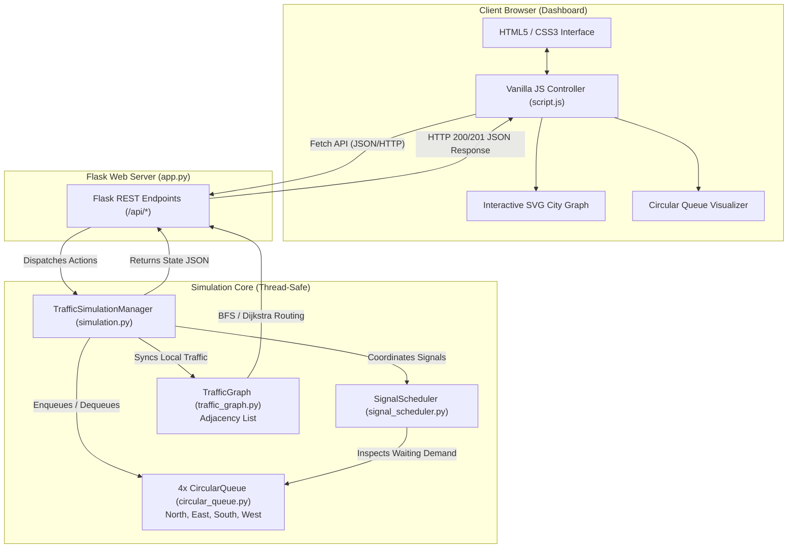

# Traffic Signal Control System

**Intelligent Traffic Monitoring & Analysis**  
*A Web-Based Simulation of Local Intersection Scheduling and City-Wide Road Network Routing*

---

## 1. Project Introduction

The **Traffic Signal Control System** is a locally runnable, web-based traffic simulation and analysis application developed using Python, Flask, and Vanilla JavaScript. It demonstrates the practical application of fundamental Data Structures and Algorithms (DSA) to solve real-world urban transportation and traffic management challenges.

The application integrates two complementary tiers of traffic engineering:
1. **Micro-Level Intersection Scheduling:** Simulates a four-way intersection (North, East, South, West approaches) using custom array-based **Circular Queues** to manage vehicle arrival order, prevent false queue overflow, maintain zero conflicting traffic movements, and provide emergency vehicle preemption with starvation safeguards.
2. **Macro-Level Road Network Analysis:** Models a smart-city road network as a directed, weighted **Graph (Adjacency List)**, implementing **Breadth-First Search (BFS)** for unweighted minimum-hop routing and **Dijkstra's Algorithm** with Bureau of Public Roads (BPR) congestion delay modeling for optimal weighted route planning.

The system features an interactive, real-time web dashboard that visualizes signal phase transitions, live vehicle queues, physical stop lines, internal circular queue memory states (with front and rear pointers), and an interactive SVG-rendered city road network.

> [!NOTE]
> **Educational & Demonstration Scope:** This application is strictly an educational simulation and algorithm demonstration platform. It is designed to illustrate computer science data structures, graph theory, and scheduling policies in an interactive visual environment. It is not intended for deployment as a production traffic controller and does not interface with physical municipal traffic signal hardware.

---

## 2. Problem Statement

Modern urban intersections face severe congestion, increased emissions, and safety hazards due to inefficient traffic flow management. At any signalized intersection, several critical operational challenges arise:

1. **FIFO Order Maintenance:** Vehicles approaching an intersection arrive sequentially. The control system must ensure First-In, First-Out (FIFO) service so that vehicles waiting the longest are cleared first.
2. **Memory Recycling & False Overflow:** When using standard linear array queues, dequeuing a vehicle from the front leaves unused memory at the beginning. In naive implementations, either every subsequent vehicle must be shifted forward—incurring an expensive $\mathcal{O}(N)$ processing overhead per departure—or the array quickly hits its boundary while earlier slots sit empty (false overflow).
3. **Fair Service Distribution:** Traffic lights must cycle through all approaches systematically. Without a deterministic scheduling policy, high-density approaches can monopolize the green light, causing prolonged delays on minor cross-streets.
4. **Collision Prevention:** Simultaneous green lights on intersecting roads lead to vehicular collisions. The control logic must guarantee that only non-conflicting traffic streams are granted green or yellow clearance, with all conflicting directions held at red.
5. **Emergency Vehicle Handling:** Ambulances, fire engines, and police vehicles require prompt clearance. However, repeatedly overriding the normal signal cycle for emergency traffic can lead to total starvation of commuter traffic if no safeguards exist.
6. **Network-Wide Connectivity & Congestion:** Local intersection management cannot observe upstream or downstream bottlenecks. Drivers need routing algorithms that account for distance, capacity limits, and real-time congestion across the broader road network.

### Why Circular Queues and Graph Algorithms Solve These Problems

- **Circular Queues:** By utilizing a fixed-capacity array with front and rear pointers governed by modulo arithmetic $(index + 1) \pmod{\text{capacity}}$, circular queues achieve true $\mathcal{O}(1)$ time complexity for both `enqueue` and `dequeue` operations. They eliminate element shifting and continuously reuse freed memory slots.
- **Graph Algorithms:** By modeling intersections as vertices and roadways as directed weighted edges, graph traversal algorithms such as BFS and Dijkstra provide systematic, mathematically proven routes for navigating the city, balancing congestion, and evaluating network connectivity.

---

## 3. Objectives

The primary objectives of the Traffic Signal Control System project are:

### Implemented Functionality
- **Implement Custom Circular Queues:** Build a pure Python circular queue class from scratch using fixed-size array storage and modulo-based index wrap-around for all four directional approaches.
- **Demonstrate FIFO Vehicle Processing:** Enqueue vehicles at the rear pointer and dequeue departing vehicles from the front pointer during active green phases.
- **Enforce Single Movement Safety Invariants:** Ensure that exactly one direction displays GREEN or YELLOW at any given time, while all other three directions display RED.
- **Implement Deterministic Signal Scheduling:** Support both standard Round-Robin cycling and Adaptive Priority scheduling with mandatory yellow caution intervals.
- **Support Emergency Vehicle Priority with Safeguards:** Enable emergency preemption (Ambulances, Fire Engines, Police Vehicles) while preventing commuter starvation through consecutive-grant limits and waiting-time thresholds.
- **Model Road Networks as Graphs:** Represent smart-city intersections and roadways via an Adjacency List storing road lengths, speed limits, vehicle capacities, and current volumes.
- **Implement Route Finding Algorithms:** Provide interactive route calculation using BFS (minimum intersection hops) and Dijkstra's algorithm (minimum travel delay using the BPR formula).
- **Deliver Real-Time Visual Telemetry:** Provide an interactive browser dashboard displaying queue arrays, signal states, physical stop lines, performance metrics, and network congestion scores.
- **Evaluate Micro vs Macro Tradeoffs:** Provide an automated comparative analysis comparing intersection queuing against network graph routing.
- **Ensure Code Quality and Test Coverage:** Provide a modular backend with comprehensive unit tests for circular queues, signal scheduling, graph routing, and REST API endpoints.

### Planned Enhancements (Future Scope)
- Dynamic traffic density estimation using computer vision and camera feeds.
- Multi-lane intersections supporting concurrent protected left-turn phases.
- Multi-intersection coordination (green-wave progression) across arterial corridors.
- Persistent database storage for historical traffic pattern logging.

---

## 4. Features

### 4.1 Traffic Intersection
- **Four Cardinal Approaches:** Manages North, East, South, and West directional approaches converging at a central junction.
- **Signal States:** Each approach transitions through standard `RED`, `YELLOW`, and `GREEN` signal phases.
- **Anti-Collision Guarantee:** The system enforces that only one directional movement group receives green/yellow clearance at any time; all conflicting approaches are locked at red.
- **Safe Phase Transitions:** Prior to switching green service to a new direction, the active direction enters a mandatory yellow clearance phase (default: 3 seconds) to clear trailing vehicles safely.

### 4.2 Vehicle Management
- **Unique Vehicle Identifiers:** Standard commuter vehicles receive sequential identifiers (e.g., `VEH-0001`), while emergency vehicles receive priority identifiers (e.g., `EMG-001`).
- **Supported Vehicle Types:**
  - Standard: `Car`, `Bus`, `Truck`, `Bike`.
  - Emergency: `Ambulance` (Priority 1), `Fire Engine` (Priority 2), `Police Vehicle` (Priority 3).
- **FIFO Clearance:** Vehicles are queued strictly in order of arrival and depart strictly from the front of the queue during green phases.
- **Fixed Capacity Constraints:** Each approach queue has a default capacity of 8 vehicles, preventing unbounded memory consumption.
- **Batch Vehicle Injection:** A dedicated control button allows injecting a batch of random vehicles across approaches for rapid testing.

### 4.3 Circular Queue Visualization
- **Memory Slot Representation:** The dashboard displays an 8-slot array for each direction, showing exact numeric slot indices `0` through `7`.
- **Pointer Indicators:** The visualizer dynamically highlights the `front` pointer (green), `rear` pointer (amber), and active occupancy status of every slot.
- **Wrap-Around Demonstration:** When dequeues free lower indices and subsequent enqueues cause the rear pointer to wrap from index `7` back to index `0`, a visual callout notifies the user of modulo wrap-around in action.
- **Complexity Telemetry:** Real-time display confirming $\mathcal{O}(1)$ time complexity for enqueue, dequeue, and peek operations.

### 4.4 Traffic Signal Scheduler
- **Scheduling Strategies:**
  - **Round-Robin (`round_robin`):** Cycles through directions in fixed clockwise sequence: $\text{North} \to \text{East} \to \text{South} \to \text{West}$.
  - **Adaptive Priority (`adaptive_priority`):** Evaluates waiting queues dynamically. Detects emergency vehicles first; if none are present, evaluates queue length and accumulated waiting time using a weighted urgency formula:
    $$\text{Score} = (2.5 \times \text{Queue Length}) + (1.0 \times \text{Wait Time})$$
- **Starvation Prevention Mechanism:** To prevent emergency vehicles from permanently starving other approaches, the scheduler tracks consecutive emergency grants ($\kappa$). If an approach reaches $\kappa_{\max} = 2$ consecutive cycles and an opposing queue has waited longer than 15 seconds, the starved direction is granted an immediate green cycle.
- **Configurable Durations:** Green light duration (default: 8s) and yellow light duration (default: 3s) can be modified on the fly via the Settings modal.

### 4.5 Graph-Based Traffic Analysis
- **Smart-City Topology:** Models 7 realistic intersections with coordinate-based positioning for SVG rendering:
  - `INT-1`: Central Junction (Hub)
  - `INT-2`: North Metro Terminal
  - `INT-3`: East Tech Corridor
  - `INT-4`: South Ring Interchange
  - `INT-5`: West University Gate
  - `INT-6`: Uptown Health City (Emergency/Hospital Sector)
  - `INT-7`: Harbour Logistics Point
- **Adjacency List Structure:** Stores vertices and directed road edges with distance (km), capacity (veh/hr), current vehicle load, and speed limits (km/h).
- **Breadth-First Search (BFS):** Calculates the shortest path based on the minimum number of intermediate intersection hops (unweighted view).
- **Dijkstra's Algorithm:** Calculates the optimal route minimizing total travel time by factoring real-time road congestion using the Bureau of Public Roads (BPR) delay formulation.
- **Dynamic Route Highlighting:** Computed routes are highlighted in blue on the interactive SVG canvas, along with hop count, total distance, estimated travel time, and average congestion ratio.
- **Network Congestion Score:** Continuously aggregates vehicle volumes across all edges to display an overall city congestion index (0% to 100%).

### 4.6 Statistics and Event Logs
- **Real-Time Performance Cards:**
  - *Vehicles Waiting:* Total count of queued vehicles across all four approaches.
  - *Vehicles Served:* Total count of vehicles cleared through green lights.
  - *Average Waiting Time:* Mean time (seconds) elapsed between vehicle arrival and departure.
  - *Traffic Throughput:* Rate of vehicles cleared per simulated minute.
  - *Emergency Waiting:* Number of active emergency vehicles awaiting service.
- **Sliding Event Audit Feed:** A chronological audit log displaying phase changes, vehicle arrivals, vehicle departures, emergency priority overrides, and starvation prevention triggers.

### 4.7 Simulation Controls
- **Start:** Launches the background simulation loop (1 tick per second).
- **Pause:** Pauses the simulation clock without losing queue states or metrics.
- **Resume:** Resumes execution from the exact paused timestamp.
- **Reset:** Clears all queues, resets scheduler timers, restores initial sample vehicles, and returns state to `STOPPED`.
- **Step (+1s):** Advances the simulation by exactly 1 second deterministically, allowing frame-by-frame inspection of phase timing and departures.
- **Batch (+4 Veh):** Injects four random vehicles across directions for demonstration.
- **Settings:** Opens a configuration modal to adjust green duration, yellow duration, and scheduling strategy.

---

## 5. Technology Stack

| Layer | Technology | Purpose & Justification |
| :--- | :--- | :--- |
| **Structure** | HTML5 | Semantic layout, modular cards, accessible form elements, and SVG viewports. |
| **Styling** | CSS3 (Vanilla) | Modern dark navy theme (`#0b1120`), glowing signal indicators, flexbox/grid layouts, and responsive panels without heavy CSS frameworks. |
| **Frontend Logic** | JavaScript (ES6+ Vanilla) | Asynchronous polling (`fetch`), DOM updates, SVG graph drawing, route highlighting, and event handling. No external JS libraries required. |
| **Backend Core** | Python 3 | Pure algorithmic implementations of Circular Queues, Signal Schedulers, Simulation Managers, and Graph Algorithms. |
| **Web Server & API**| Flask ($\ge 3.0.0$) | Lightweight WSGI web framework exposing REST endpoints and serving the single-page application. |
| **Routing / Utilities**| Werkzeug ($\ge 3.0.0$) | Underlying WSGI web server and request routing library for Flask. |
| **Vector Graphics** | SVG / CSS | Interactive 2D road network visualization with color-coded congestion strokes and dynamic path animations. |
| **Automated Testing**| Python `unittest` | Built-in test framework for unit and integration testing across all algorithmic modules and REST endpoints. |

### External Dependencies
As specified in [requirements.txt](requirements.txt):
```txt
Flask>=3.0.0
Werkzeug>=3.0.0
```
- **Zero Cloud or Paid Dependencies:** The application runs entirely on the local loopback interface (`127.0.0.1:5000`). No external API keys, database servers, or cloud subscriptions are needed.

---

## 6. System Architecture

### Request and Data Flow
1. **User Interaction:** The user interacts with the web dashboard (clicks simulation controls, adds vehicles, adjusts settings, or requests a graph route).
2. **HTTP Dispatch:** Vanilla JavaScript sends asynchronous HTTP requests (`GET` or `POST`) with JSON payloads to Flask REST endpoints.
3. **Endpoint Validation:** Flask routes in `app.py` validate request parameters (directions, vehicle types, intersection IDs, step durations).
4. **Simulation Coordination:** The central `TrafficSimulationManager` (`algorithms/simulation.py`) coordinates state updates under a thread-safe reentrant lock (`threading.RLock`).
5. **Queue Processing:** The `CircularQueue` instances (`algorithms/circular_queue.py`) manage vehicle arrival insertion and departure extraction using modulo arithmetic.
6. **Signal State Machine:** The `SignalScheduler` (`algorithms/signal_scheduler.py`) evaluates elapsed phase times, advances green/yellow states, and selects the next active approach based on the configured policy.
7. **Graph Analysis:** The `TrafficGraph` (`algorithms/traffic_graph.py`) processes route traversal requests via BFS or Dijkstra and updates congestion metrics.
8. **JSON Serialization:** Flask serializes updated state dictionaries and returns JSON responses with appropriate HTTP status codes.
9. **Dashboard Update:** The frontend polling loop (running every 800ms) receives the latest state, updating traffic lights, vehicle queues, circular queue memory slots, statistics cards, and event logs.

### Architecture Diagram



### Module Responsibilities
- **`app.py`:** Flask application entry point. Defines routes, parses request arguments, performs HTTP validation, and delegates business logic to `simulation`.
- **`algorithms/circular_queue.py`:** Implements the `CircularQueue` data structure using a fixed-size Python list, front/rear pointers, modulo index calculations, and boundary error handling (`QueueOverflowError`, `QueueUnderflowError`).
- **`algorithms/signal_scheduler.py`:** Implements `SignalScheduler`, `SignalState` (RED, YELLOW, GREEN), and `SchedulingStrategy` (ROUND_ROBIN, ADAPTIVE_PRIORITY). Manages safe phase progression, collision prevention, emergency preemption, and starvation safeguards.
- **`algorithms/traffic_graph.py`:** Implements `TrafficGraph`, `Intersection`, and `RoadEdge`. Manages adjacency lists, calculates BPR travel delays, executes BFS and Dijkstra algorithms, and generates the 7-node sample city network.
- **`algorithms/simulation.py`:** Implements `TrafficSimulationManager`. Serves as the central thread-safe orchestrator managing directional queues, signal timers, background ticking threads, metric computations, and comparative experiments.

---

## 7. Data Structures and Algorithms

### 7.1 Circular Queue

The circular queue is an abstract data structure that behaves as a First-In, First-Out (FIFO) buffer implemented over a contiguous, fixed-size memory array. In a conventional linear queue implemented over a fixed array, advancing the `front` pointer leaves vacant memory at the beginning of the array that cannot be reused without shifting every remaining element left by one position ($\mathcal{O}(N)$ operation).

A **Circular Queue** connects the last array index back to index `0` conceptually using modulo arithmetic:

$$\text{next\_index} = (\text{current\_index} + 1) \pmod{\text{capacity}}$$

#### Internal Pointers and Invariants
- `capacity`: Maximum number of items the queue can store ($C = 8$).
- `array`: Fixed-size list of length $C$, initialized to `[None] * capacity`.
- `front`: Index of the earliest inserted element currently in the queue. Initialized to `-1`.
- `rear`: Index of the most recently inserted element. Initialized to `-1`.
- `size`: Current count of active elements ($0 \le \text{size} \le C$).

#### Conditions
- **Empty Condition:** $\text{size} == 0$ (or $\text{front} == -1$).
- **Full Condition:** $\text{size} == \text{capacity}$.
- **Enqueue Operation:** If full, raises `QueueOverflowError`. If empty, sets `front = rear = 0`. Otherwise, sets $\text{rear} = (\text{rear} + 1) \pmod{C}$. Stores item at `array[rear]` and increments `size`.
- **Dequeue Operation:** If empty, raises `QueueUnderflowError`. Extracts item at `array[front]` and sets `array[front] = None`. If $\text{front} == \text{rear}$, the queue becomes empty and resets $\text{front} = \text{rear} = -1$. Otherwise, sets $\text{front} = (\text{front} + 1) \pmod{C}$ and decrements `size`.

#### Implementation Code Reference

```python
# Simplified from algorithms/circular_queue.py
class CircularQueue:
    def __init__(self, capacity: int = 8):
        self.capacity = capacity
        self.array = [None] * self.capacity
        self.front = -1
        self.rear = -1
        self.size = 0

    def enqueue(self, item) -> bool:
        if self.size == self.capacity:
            raise QueueOverflowError("Queue is full.")
        if self.size == 0:
            self.front = 0
            self.rear = 0
        else:
            self.rear = (self.rear + 1) % self.capacity
        self.array[self.rear] = item
        self.size += 1
        return True

    def dequeue(self):
        if self.size == 0:
            raise QueueUnderflowError("Queue is empty.")
        item = self.array[self.front]
        self.array[self.front] = None
        if self.front == self.rear:
            self.front = -1
            self.rear = -1
        else:
            self.front = (self.front + 1) % self.capacity
        self.size -= 1
        return item
```

#### Circular Queue Complexity Analysis
- **Enqueue:** $\mathcal{O}(1)$ time — direct pointer update and array indexing.
- **Dequeue:** $\mathcal{O}(1)$ time — direct pointer update, zero element shifting.
- **Peek:** $\mathcal{O}(1)$ time — direct lookup at `array[front]`.
- **Space Complexity:** $\mathcal{O}(C)$ — strictly bounded by the fixed capacity $C$.

---

### 7.2 Round-Robin Scheduling

Under the `round_robin` policy, the scheduler cycles service across all four directional approaches sequentially:

$$\text{North} \longrightarrow \text{East} \longrightarrow \text{South} \longrightarrow \text{West} \longrightarrow \text{North}$$

#### Phase Advancement Rules
1. The active direction holds `GREEN` for $\tau_{\text{green}}$ seconds (default: 8s).
2. Upon timer expiration, the direction transitions to `YELLOW` for $\tau_{\text{yellow}}$ seconds (default: 3s).
3. Upon yellow expiration, the scheduler selects:
   $$\text{next\_index} = (\text{active\_index} + 1) \pmod{4}$$
4. The previous direction reverts to `RED`, and the newly selected direction becomes `GREEN`.

---

### 7.3 Emergency Priority Scheduling

Under the `adaptive_priority` policy, the scheduler inspects queues to grant immediate service to emergency vehicles while preventing normal commuter starvation.

#### Scheduling Logic
1. **Emergency Scan:** The scheduler iterates over the FIFO items in all four approach queues. If an emergency vehicle is detected, it is placed in an emergency candidate list with its priority rating:
   - Priority 1: `Ambulance`
   - Priority 2: `Fire Engine`
   - Priority 3: `Police Vehicle`
2. **Priority Selection:** Candidates are sorted primarily by priority rating (ascending, 1 before 2 before 3) and secondarily by arrival time.
3. **Starvation Safeguard:** The scheduler maintains an emergency streak counter $\kappa(d)$ for each direction $d$. If an approach has received green priority for $\kappa(d) \ge 2$ consecutive cycles, and another waiting non-emergency queue has an oldest vehicle waiting longer than 15 seconds, the scheduler overrides the emergency streak:
   - The starved direction receives an immediate green cycle.
   - An audit event `STARVATION_PREVENTION` is logged.
   *(Note: If no opposing commuter queue has waited beyond the 15-second threshold, emergency traffic continues to be prioritized, preventing unnecessary preemption interruption when cross-streets are not severely delayed).*
4. **Demand Balancing (No Emergency):** If no emergency vehicles are present, the scheduler calculates an urgency score for each non-empty queue:
   $$\text{Score}(d) = (2.5 \times \text{len}(\text{queue}_d)) + (1.0 \times \text{wait\_time}_d)$$
   The direction with the highest score is selected. If the selected direction is currently active and other queues are waiting, the second-highest approach is served to guarantee fairness.

---

### 7.4 Graph Representation

The smart-city road network is represented as an **Adjacency List** using a Python dictionary mapping intersection node IDs to lists of directed `RoadEdge` objects:

$$\text{adjacency}: \mathcal{V} \longrightarrow \text{List}[\text{RoadEdge}]$$

Each `Intersection` vertex stores:
- `node_id`: Unique identifier (e.g., `"INT-1"`).
- `name`: Human-readable name (e.g., `"Central Junction"`).
- `x`, `y`: Coordinate position on the 600×420 SVG canvas.
- `node_type`: Role (e.g., `"Central Hub"`, `"Transit Hub"`, `"Emergency / Hospital"`).

Each `RoadEdge` directed connection stores:
- `from_node`, `to_node`: Origin and target intersection IDs.
- `distance_km`: Physical road length in kilometers.
- `capacity`: Maximum vehicular capacity (vehicles/hour).
- `current_vehicles`: Real-time vehicle load.
- `speed_limit_kmh`: Posted speed limit (km/h).

---

### 7.5 Breadth-First Search (BFS)

BFS finds the path with the minimum number of road connections (intermediate intersection hops) between a source vertex and a target vertex in an unweighted view of the graph.

#### Algorithm Steps
1. Enqueue the start vertex into a FIFO queue (`collections.deque`) and mark it as visited.
2. Initialize a `parent` mapping to reconstruct the path upon termination.
3. While the queue is non-empty, dequeue vertex $u$. If $u == \text{target}$, terminate early.
4. For each outgoing edge $(u, v)$ in $\text{adjacency}[u]$, if $v$ has not been visited, mark $v$ as visited, record $u$ as the parent of $v$, and enqueue $v$.
5. Reconstruct the shortest path by backtracking from the target vertex to the source vertex using the `parent` pointers.

#### BFS Complexity Analysis
- **Time Complexity:** $\mathcal{O}(|V| + |E|)$ where $|V|$ is the number of intersections and $|E|$ is the number of road segments.
- **Space Complexity:** $\mathcal{O}(|V|)$ to store the visited set, parent dictionary, and queue.

---

### 7.6 Dijkstra's Algorithm

Dijkstra's algorithm finds the optimal path between a source intersection and a target intersection that minimizes cumulative travel delay, actively steering traffic away from congested roads.

#### Congestion Modeling (Bureau of Public Roads Formula)
To determine edge weights dynamically, the project implements the standard **Bureau of Public Roads (BPR)** delay formulation:

$$\text{Congestion Ratio } (R) = \frac{\text{current\_vehicles}}{\text{capacity}}$$

$$\text{Free-Flow Travel Time } (t_0) = \left(\frac{\text{distance\_km}}{\text{speed\_limit\_kmh}}\right) \times 60.0 \quad (\text{minutes})$$

$$\text{Congestion Penalty} = 1.0 + \left(\alpha \times R^\beta\right)$$

$$\text{Effective Travel Cost } (t_{\text{effective}}) = t_0 \times \left(1.0 + 1.2 \times R^2\right) \quad (\text{minutes})$$

Where:
- $\alpha = 1.2$: Congestion weighting coefficient.
- $\beta = 2.0$: Exponential delay exponent reflecting nonlinear traffic slowdowns as volume approaches capacity.

#### Algorithm Steps
1. Initialize a distance table mapping all vertices $v \in V$ to $+\infty$, with $\text{distances}[\text{source}] = 0.0$.
2. Maintain a min-heap priority queue (`heapq`) storing tuples of `(cost, node_id)`. Push `(0.0, source)`.
3. Pop the vertex $u$ with the smallest accumulated travel cost. If $u$ has already been finalized, skip it.
4. If $u == \text{target}$, stop traversal.
5. For each outgoing edge $(u, v)$ from $u$, calculate:
   $$\text{new\_cost} = \text{distances}[u] + \text{edge.travel\_cost\_minutes}$$
   If $\text{new\_cost} < \text{distances}[v]$:
   - Update $\text{distances}[v] = \text{new\_cost}$.
   - Record $u$ as the predecessor of $v$.
   - Push `(new_cost, v)` into the priority queue.
6. Backtrack from target to source to construct the minimum-delay route.

#### Dijkstra Complexity Analysis
- **Time Complexity:** $\mathcal{O}((|V| + |E|) \log |V|)$ using a binary min-heap (`heapq`).
- **Space Complexity:** $\mathcal{O}(|V|)$ to store the distance dictionary, visited set, parent pointers, and priority queue.

---

### 7.7 Summary of Algorithms

| Algorithm / Data Structure | Module | Purpose | Time Complexity (Best) | Time Complexity (Worst) | Space Complexity |
| :--- | :--- | :--- | :--- | :--- | :--- |
| **Circular Queue (`enqueue`)** | `algorithms.circular_queue` | Inserts vehicle at rear pointer using modulo wrap-around | $\mathcal{O}(1)$ | $\mathcal{O}(1)$ | $\mathcal{O}(C)$ |
| **Circular Queue (`dequeue`)** | `algorithms.circular_queue` | Clears vehicle from front pointer during green phase | $\mathcal{O}(1)$ | $\mathcal{O}(1)$ | $\mathcal{O}(C)$ |
| **Circular Queue (`peek`)** | `algorithms.circular_queue` | Inspects next vehicle to depart without removing | $\mathcal{O}(1)$ | $\mathcal{O}(1)$ | $\mathcal{O}(1)$ |
| **Round-Robin Scheduler** | `algorithms.signal_scheduler` | Advances signal phases in fixed sequential order | $\mathcal{O}(1)$ | $\mathcal{O}(1)$ | $\mathcal{O}(1)$ |
| **Adaptive Priority Scheduler**| `algorithms.signal_scheduler` | Evaluates emergency preemption, demand, and starvation | $\mathcal{O}(|\mathcal{D}|) = \mathcal{O}(1)$ | $\mathcal{O}(|\mathcal{D}| \cdot C) = \mathcal{O}(1)$ | $\mathcal{O}(1)$ |
| **Breadth-First Search (BFS)** | `algorithms.traffic_graph` | Finds unweighted path with minimum intersection hops | $\mathcal{O}(1)$ (Start = Target) | $\mathcal{O}(|V| + |E|)$ | $\mathcal{O}(|V|)$ |
| **Dijkstra's Algorithm** | `algorithms.traffic_graph` | Finds weighted path minimizing travel delay with BPR cost | $\mathcal{O}(|V| \log |V|)$ | $\mathcal{O}((|V| + |E|) \log |V|)$ | $\mathcal{O}(|V|)$ |
| **Connected Components (BFS)**| `algorithms.traffic_graph` | Evaluates city road network connectivity | $\mathcal{O}(|V| + |E|)$ | $\mathcal{O}(|V| + |E|)$ | $\mathcal{O}(|V|)$ |

---

## 8. Queue-Based Scheduling vs Graph-Based Analysis

A core conceptual learning outcome of this project is understanding that **Queue-Based Scheduling** and **Graph-Based Analysis** are not competing algorithms for the same task. Instead, they are **complementary techniques operating at two distinct tiers of the transportation hierarchy**.

### Comparison Table

| Attribute | Micro-Level Queue Scheduling | Macro-Level Graph Analysis |
| :--- | :--- | :--- |
| **Operational Scope** | Single 4-way intersection (lane-level) | Multi-junction city road network |
| **Primary Data Structure** | Fixed-capacity **Circular Queue** with modulo arithmetic | **Graph (Adjacency List)** with Min-Heap Priority Queue |
| **Inputs** | Vehicle arrivals, directional queues, vehicle types, waiting durations | Intersection vertices, road lengths, capacities, speed limits, vehicle loads |
| **Outputs** | Active signal color (GREEN/YELLOW/RED), vehicle departure order, clearance events | Point-to-point routes, minimum hops, travel delay estimates, network congestion score |
| **Typical Complexity** | $\mathcal{O}(1)$ Enqueue / Dequeue | BFS: $\mathcal{O}(|V| + |E|)$ \| Dijkstra: $\mathcal{O}((|V| + |E|) \log |V|)$ |
| **Key Advantage** | Eliminates array element shifting, prevents collision conflicts, bounds memory to capacity | Identifies bypass routes around congestion bottlenecks, evaluates city connectivity |
| **Key Limitation** | Has no visibility into upstream or downstream road network conditions | Cannot resolve physical collision conflicts between individual vehicles at a signal |
| **How Project Uses It** | Manages North, East, South, and West approach lanes at Central Junction (`INT-1`) | Routes vehicles between 7 smart-city intersections and balances city-wide congestion |

---

## 9. Project Directory Structure

```
Traffic_Signal_Control_System/
│
├── app.py                          # Main Flask web application and REST API endpoints
├── requirements.txt                # Lightweight Python package dependencies (Flask, Werkzeug)
├── run.bat                         # Windows one-click launcher batch script
├── README.md                       # Comprehensive system documentation and user guide
├── .gitignore                      # Git version control ignore rules
│
├── algorithms/                     # Pure Python Data Structures and Algorithms package
│   ├── __init__.py                 # Python package initializer
│   ├── circular_queue.py           # Array-based Circular Queue with modulo wrap-around (O(1))
│   ├── signal_scheduler.py         # Signal state machine, phase transitions, and emergency priority
│   ├── traffic_graph.py            # Graph adjacency list, BPR delay formula, BFS, and Dijkstra
│   └── simulation.py               # Central thread-safe simulation manager and background ticker
│
├── templates/                      # HTML template directory
│   └── index.html                  # Full single-page dashboard layout, controls, and SVG containers
│
├── static/                         # Frontend static asset directory
│   ├── css/
│   │   └── style.css               # Vanilla CSS stylesheet (dark navy theme, glowing LEDs, responsive grid)
│   └── js/
│       └── script.js               # Vanilla JavaScript frontend controller, polling, and SVG rendering
│
├── tests/                          # Automated unit test suite (Python unittest)
│   ├── test_circular_queue.py      # Unit tests for CircularQueue (FIFO, wrap-around, overflow, underflow)
│   ├── test_signal_scheduler.py    # Unit tests for SignalScheduler (phases, safety invariant, priority)
│   ├── test_traffic_graph.py       # Unit tests for TrafficGraph (BFS hops, Dijkstra costs, connectivity)
│   └── test_api.py                 # Integration tests for Flask REST API endpoints
│
└── docs/                           # Supplementary theoretical and verification documentation
    ├── algorithm.md                # Mathematical formulations, BPR equations, and theoretical complexities
    └── test_cases.md               # Complete verification matrix covering all 36 automated unit test cases
```

### File and Folder Responsibilities
- **`app.py`:** Initializes the Flask application, mounts the single `TrafficSimulationManager` instance, defines all 16 REST endpoints, validates input payloads, and returns structured JSON responses.
- **`algorithms/`:** Contains pure Python algorithmic modules with zero third-party dependencies. Modules can be imported and tested independently of Flask.
- **`templates/index.html`:** The HTML5 structure for the complete dashboard, including the top navbar, telemetry banner, control buttons, intersection graphic, queue lists, circular queue memory visualizer, SVG graph canvas, and settings modal.
- **`static/css/style.css`:** Custom styling containing design tokens, glassmorphism card surfaces, road marking styles, glowing traffic light bulbs, and animated vehicle crossing effects.
- **`static/js/script.js`:** Manages client-side state, runs the 800ms polling cycle to synchronize with backend state, handles user button clicks, generates SVG graph elements, and renders circular queue slot memory models.
- **`tests/`:** Contains automated unit tests organized by module. Executable via Python's standard `unittest` discovery runner.
- **`docs/`:** Supplementary markdown references providing detailed mathematical equations ([algorithm.md](docs/algorithm.md)) and test verification matrices ([test_cases.md](docs/test_cases.md)).

---

## 10. Installation and Setup on Windows

Follow this step-by-step guide to configure and run the application on a Windows workstation using PowerShell or Command Prompt.

### Prerequisites
- **Python 3.8 or newer:** Download and install from [python.org](https://www.python.org/). Ensure you check the box **"Add Python to PATH"** during installation.
- **Web Browser:** Google Chrome, Microsoft Edge, or Mozilla Firefox.

---

### Step 1: Open the Project Directory
Open PowerShell or Command Prompt, then navigate to the project directory:

```powershell
cd D:\Documents\DSA\Traffic_Signal_Control_System
```

---

### Step 2: Verify Python Installation
Confirm that Python is installed and accessible:

```powershell
py --version
```
*(If `py` is not recognized, try `python --version`)*

---

### Step 3: Create a Clean Virtual Environment
Create an isolated virtual environment named `.venv`:

```powershell
py -m venv .venv
```

---

### Step 4: Activate the Virtual Environment
Activate the environment in PowerShell:

```powershell
.\.venv\Scripts\Activate.ps1
```

> [!TIP]
> **PowerShell Execution Policy Workaround:** If Windows blocks script activation with the message `Activate.ps1 cannot be loaded because running scripts is disabled on this system`, apply a session-only execution policy bypass. This command only affects your current terminal window and does not alter permanent system-wide security policies:

```powershell
Set-ExecutionPolicy -Scope Process -ExecutionPolicy Bypass
.\.venv\Scripts\Activate.ps1
```

Alternatively, in standard Windows Command Prompt (`cmd.exe`), run:
```cmd
.\.venv\Scripts\activate.bat
```

---

### Step 5: Install Project Dependencies
Install the required packages from `requirements.txt`:

```powershell
python -m pip install --upgrade pip
python -m pip install -r requirements.txt
```

---

### Step 6: Run Automated Tests
Execute the automated test suite to confirm that all data structures, scheduling policies, graph algorithms, and REST endpoints are functional:

```powershell
python -m unittest discover -s tests -v
```

---

### Step 7: Launch the Application
Start the Flask development server:

```powershell
python app.py
```

The terminal will print the local server output:
```
 * Serving Flask app 'app'
 * Debug mode: off
 * Running on http://127.0.0.1:5000
Press CTRL+C to quit
```

---

### Step 8: Open the Dashboard
Open your web browser and navigate to:
```
http://127.0.0.1:5000
```

---

### Alternative: One-Click Launch (Windows)
For convenience, you can also launch the application by double-clicking [run.bat](run.bat) from Windows File Explorer or executing:
```powershell
.\run.bat
```
This batch script automatically opens the browser at `http://127.0.0.1:5000` and starts the Flask server.

---

## 11. REST API Documentation

The backend exposes a clean REST API returning JSON responses. All endpoints are prefixed with `/api`.

### Summary of Endpoints

| HTTP Method | Endpoint | Description | Request Body | Success Status |
| :--- | :--- | :--- | :--- | :--- |
| `GET` | `/api/health` | Backend health and simulation status | None | `200 OK` |
| `GET` | `/api/state` | Complete simulation telemetry, queues, signals, and stats | None | `200 OK` |
| `POST` | `/api/simulation/start` | Start the real-time background simulation clock | None | `200 OK` |
| `POST` | `/api/simulation/pause` | Pause the simulation clock | None | `200 OK` |
| `POST` | `/api/simulation/resume` | Resume the paused simulation clock | None | `200 OK` |
| `POST` | `/api/simulation/reset` | Reset simulation state, queues, and timers | None | `200 OK` |
| `POST` | `/api/simulation/step` | Advance simulation by a deterministic duration (`dt` seconds) | `{"dt": 1}` | `200 OK` |
| `POST` | `/api/simulation/config` | Update green/yellow durations and scheduling strategy | `{"green_duration": 8, "yellow_duration": 3, "strategy": "adaptive_priority"}` | `200 OK` |
| `POST` | `/api/vehicles/add` | Enqueue a vehicle into a directional circular queue | `{"direction": "North", "vehicle_type": "Car"}` | `201 Created` |
| `POST` | `/api/vehicles/batch` | Add a generated batch of vehicles across directions | `{"count": 4}` | `201 Created` |
| `GET` | `/api/queues` | Return raw array slots, pointers, and FIFO order for all 4 queues | None | `200 OK` |
| `GET` | `/api/analytics` | Return live computed traffic performance metrics | None | `200 OK` |
| `GET` | `/api/graph` | Return road network vertices, edges, and congestion score | None | `200 OK` |
| `POST` | `/api/graph/route` | Calculate route via BFS or Dijkstra between intersections | `{"source": "INT-6", "destination": "INT-1", "algorithm": "bfs"}` | `200 OK` / `404 Not Found` |
| `GET` | `/api/comparison` | Return experimental micro-vs-macro comparative analysis | None | `200 OK` |
| `GET` | `/api/events` | Return chronological audit log of phase changes and actions | Optional query param: `?limit=50` | `200 OK` |

---

### Detailed Endpoint Specifications and Examples

#### 1. Health Check

- **Endpoint:** `GET /api/health`
- **Response (`200 OK`):**

```json
{
  "service": "Traffic Signal Control System API",
  "simulation_status": "STOPPED",
  "status": "healthy",
  "version": "1.0.0"
}
```

#### 2. Get Simulation State

- **Endpoint:** `GET /api/state`
- **Response (`200 OK`):**

```json
{
  "active_direction": "North",
  "current_phase": "GREEN",
  "phase_elapsed": 2,
  "remaining_phase_time": 6,
  "signals": {
    "North": "GREEN",
    "East": "RED",
    "South": "RED",
    "West": "RED"
  },
  "sim_time": 14,
  "status": "RUNNING",
  "statistics": {
    "average_waiting_time": 4.5,
    "emergency_waiting": 1,
    "total_arrived": 12,
    "total_served": 6,
    "total_waiting": 6,
    "traffic_throughput_per_min": 25.71
  }
}
```

#### 3. Add Vehicle

- **Endpoint:** `POST /api/vehicles/add`
- **Headers:** `Content-Type: application/json`

**Request Body (Standard Vehicle):**

```json
{
  "direction": "North",
  "vehicle_type": "Car"
}
```

**Response (`201 Created`):**

```json
{
  "message": "Vehicle VEH-0008 queued at North.",
  "queue_length": 3,
  "success": true,
  "vehicle": {
    "arrival_time": 14,
    "created_at": "20:30:15",
    "direction": "North",
    "id": "VEH-0008",
    "is_emergency": false,
    "priority": 0,
    "type": "Car"
  }
}
```

**Request Body (Emergency Vehicle):**

```json
{
  "direction": "East",
  "vehicle_type": "Ambulance"
}
```

**Response (`201 Created`):**

```json
{
  "message": "Vehicle EMG-002 queued at East.",
  "queue_length": 2,
  "success": true,
  "vehicle": {
    "arrival_time": 14,
    "created_at": "20:30:25",
    "direction": "East",
    "id": "EMG-002",
    "is_emergency": true,
    "priority": 1,
    "type": "Ambulance"
  }
}
```

**Error Responses (`400 Bad Request`):**

- Invalid direction: `{"error": "Invalid or missing direction 'NorthEast'. Valid options: ['North', 'East', 'South', 'West']."}`
- Invalid type: `{"error": "Invalid vehicle type 'Airplane'. Valid types: ['Car', 'Bus', 'Truck', 'Bike', 'Ambulance', 'Fire Engine', 'Police Vehicle']."}`
- Queue full: `{"error": "Queue Overflow: Cannot enqueue item. Capacity of 8 reached.", "message": "Queue at North is at maximum capacity (8).", "success": false}`

#### 4. Step Simulation

- **Endpoint:** `POST /api/simulation/step`
- **Request Body:**

```json
{
  "dt": 1
}
```

**Response (`200 OK`):**

```json
{
  "message": "Advanced simulation by 1 second(s).",
  "state": {
    "active_direction": "North",
    "current_phase": "GREEN",
    "signals": {
      "North": "GREEN",
      "East": "RED",
      "South": "RED",
      "West": "RED"
    },
    "sim_time": 15,
    "status": "STOPPED"
  },
  "step_info": {
    "departed_this_step": [],
    "scheduler": {
      "action_note": "Normal phase progression",
      "active_direction": "North",
      "current_phase": "GREEN",
      "phase_elapsed_time": 3,
      "transition_occurred": false
    },
    "sim_time": 15,
    "status": "STOPPED"
  },
  "success": true
}
```

#### 5. Calculate Graph Route

- **Endpoint:** `POST /api/graph/route`
- **Request Body (Dijkstra):**

```json
{
  "source": "INT-6",
  "destination": "INT-4",
  "algorithm": "dijkstra"
}
```

**Response (`200 OK`):**

```json
{
  "algorithm": "Dijkstra's Algorithm (Weighted Optimization)",
  "average_congestion_ratio": 0.33,
  "explanation": "Dijkstra optimizes for minimum travel time by factoring real-time road congestion and delay.",
  "found": true,
  "hops": 2,
  "path": ["INT-6", "INT-5", "INT-4"],
  "path_names": [
    "Uptown Health City",
    "West University Gate",
    "South Ring Interchange"
  ],
  "total_cost_minutes": 9.42,
  "total_distance_km": 7.3
}
```

**Error Response (`404 Not Found`):**

```json
{
  "algorithm": "Breadth-First Search (BFS)",
  "error": "No accessible route exists from Uptown Health City to Remote Island.",
  "found": false
}
```

#### 6. Export Queues

- **Endpoint:** `GET /api/queues`
- **Response (`200 OK`):**

Returns raw slot array for each of the four directions:

```json
{
  "capacity": 8,
  "queues": {
    "North": {
      "capacity": 8,
      "front": 0,
      "rear": 2,
      "size": 3,
      "is_empty": false,
      "is_full": false,
      "slots": [
        {"index": 0, "is_occupied": true, "is_front": true, "is_rear": false, "item": {"id": "VEH-0001", "type": "Car"}},
        {"index": 1, "is_occupied": true, "is_front": false, "is_rear": false, "item": {"id": "VEH-0002", "type": "Bus"}},
        {"index": 2, "is_occupied": true, "is_front": false, "is_rear": true, "item": {"id": "VEH-0003", "type": "Car"}},
        {"index": 3, "is_occupied": false, "is_front": false, "is_rear": false, "item": null}
      ]
    }
  }
}
```

---

## 12. Testing and Verification

The project includes an automated test suite implemented using Python's built-in `unittest` module. Tests cover individual data structures, state machine safety, graph traversals, and HTTP API endpoints.

### Test Suite Structure

```
tests/
├── test_circular_queue.py      # 8 Unit Tests (CircularQueue operations, invariants, wrap-around)
├── test_signal_scheduler.py    # 5 Unit Tests (Phase transitions, collision prevention, emergency priority)
├── test_traffic_graph.py       # 7 Unit Tests (BFS, Dijkstra, connectivity, sample city topology)
└── test_api.py                 # 16 Integration Tests (REST API routes, validation, status codes)
```

### Test Coverage Breakdown

#### 1. Circular Queue Unit Tests (`test_circular_queue.py`)
- **`test_initial_state`:** Verifies empty queue initialization, with `front == -1`, `rear == -1`, `size == 0`, and `is_empty() == True`.
- **`test_enqueue_and_fifo_order`:** Validates item insertion at rear pointer and preservation of FIFO order.
- **`test_dequeue`:** Validates front extraction, pointer progression, and slot clearing.
- **`test_full_queue_and_overflow`:** Verifies `is_full() == True` at capacity and confirms that attempting an additional enqueue raises `QueueOverflowError`.
- **`test_empty_queue_underflow`:** Verifies that attempting to dequeue or peek an empty queue raises `QueueUnderflowError`.
- **`test_wrap_around_modulo`:** Verifies that after dequeuing items from the front, new enqueues wrap the rear pointer back to index `0` and index `1` via modulo arithmetic without data corruption.
- **`test_drain_to_empty_resets_pointers`:** Verifies that draining the queue resets `front` and `rear` back to `-1`.
- **`test_get_state_structure`:** Validates the JSON export structure used for the frontend circular queue visualizer.

#### 2. Signal Scheduler Unit Tests (`test_signal_scheduler.py`)
- **`test_initial_state_and_no_conflict`:** Asserts that only North displays GREEN at $t=0$, and that East, South, and West are strictly RED (zero conflict).
- **`test_phase_progression_green_to_yellow_to_next`:** Asserts that green duration is followed by yellow caution before switching to the next direction.
- **`test_round_robin_full_cycle`:** Confirms the complete four-step cyclic progression $\text{North} \to \text{East} \to \text{South} \to \text{West}$.
- **`test_emergency_vehicle_prioritization`:** Injects an Ambulance into the West queue while a standard car is waiting in East. Verifies that West preempts East when transitioning.
- **`test_reset`:** Validates that resetting the scheduler restores initial timers, default green phase, and clears event logs.

#### 3. Traffic Graph Network Unit Tests (`test_traffic_graph.py`)
- **`test_sample_network_initialization`:** Validates that `create_sample_city_network()` creates 7 intersections, 9 bidirectional road corridors (18 directed edges), and a fully connected graph.
- **`test_bfs_shortest_path_found`:** Confirms BFS computes the unweighted 2-hop route from `INT-6` (Hospital) to `INT-1` (Central Junction).
- **`test_bfs_same_source_and_destination`:** Validates zero-hop return when origin equals target.
- **`test_bfs_disconnected_node`:** Asserts graceful handling (`found == False`) when searching for a path to an isolated node.
- **`test_dijkstra_path`:** Confirms Dijkstra calculates the weighted minimum-delay route taking congestion and speed limits into account.
- **`test_connectivity_analysis`:** Verifies that `analyze_connectivity()` correctly detects connected components and flags disconnections.
- **`test_invalid_node_handling`:** Confirms safe rejection when querying non-existent node IDs.

#### 4. Flask REST API Tests (`test_api.py`)
- Tests `/api/health`, `/api/state`, `/api/simulation/start`, `/api/simulation/pause`, `/api/simulation/resume`, `/api/simulation/reset`, `/api/simulation/step`, `/api/vehicles/add` (valid car, ambulance, invalid direction, invalid type), `/api/queues`, `/api/analytics`, `/api/graph`, `/api/graph/route` (BFS, Dijkstra, invalid node), `/api/comparison`, and `/api/events`.

### Executing the Test Suite
Run the test runner from the project root:

```powershell
python -m unittest discover -s tests -v
```

> [!IMPORTANT]
> **Test Suite Implementation vs Runtime Execution:**
> - The codebase implements exactly **36 unit tests** across four test modules: `test_circular_queue.py` (8 tests), `test_signal_scheduler.py` (5 tests), `test_traffic_graph.py` (7 tests), and `test_api.py` (16 tests).
> - Complete test case specifications, inputs, and expected invariants are documented in [docs/test_cases.md](docs/test_cases.md).
> - During this automated documentation audit, fresh test execution was restricted by sandbox environment permissions on the external Python executable. To execute and verify all tests locally, run `python -m unittest discover -s tests -v` in your activated local virtual environment.

---

## 13. Step-by-Step Demonstration Guide

Follow this guided walkthrough to demonstrate the core features of the system:

```mermaid
sequenceDiagram
    autonumber
    actor User as User / Evaluator
    participant UI as Dashboard Interface
    participant Queue as Circular Queue (Memory)
    participant Sched as Signal Scheduler
    participant Graph as City Traffic Graph

    User->>UI: 1. Launch http://127.0.0.1:5000
    UI-->>User: Displays initial stopped simulation with seeded queues

    User->>UI: 2. Click "Inspect Direction: North" in Circular Queue Visualizer
    UI->>Queue: Fetches slot array, front/rear pointers
    Queue-->>UI: Renders 8-slot array with occupied indices

    User->>UI: 3. Click "+ Car" on North Approach repeatedly
    UI->>Queue: Enqueues vehicles (O(1))
    Queue-->>UI: Rear pointer advances; size increases

    User->>UI: 4. Click "Step (+1s)" several times
    UI->>Sched: Advances clock deterministically
    Sched->>Queue: Dequeues front vehicle during GREEN phase (O(1))
    Queue-->>UI: Front pointer advances; vacated slot freed

    User->>UI: 5. Observe Modulo Wrap-Around
    Note over Queue,UI: Dequeuing from front then enqueuing at full end<br/>wraps rear pointer from index 7 back to index 0

    User->>UI: 6. Click "Start" to run real-time clock
    Sched-->>UI: GREEN light counts down → switches to YELLOW → switches to East GREEN

    User->>UI: 7. Select "West" + "Ambulance" & click "+ Queue Vehicle"
    UI->>Queue: Enqueues EMG-001 (Priority 1) at West
    Sched-->>UI: Detects emergency → Preempts next green light to West

    User->>UI: 8. Navigate to "Graph Analysis" section
    User->>UI: 9. Select Source: "INT-6" (Hospital) & Destination: "INT-4" (Interchange)
    User->>UI: 10. Select "BFS" and click "Calculate Route"
    UI->>Graph: Traverses unweighted graph
    Graph-->>UI: Highlights minimum-hop route in blue

    User->>UI: 11. Switch to "Dijkstra" and click "Calculate Route"
    UI->>Graph: Computes least-delay path factoring congestion (BPR formula)
    Graph-->>UI: Displays optimal weighted route with travel cost in minutes

    User->>UI: 12. Review Performance Cards & Event Audit Feed
    UI-->>User: Throughput, avg wait, and complete audit log displayed
```

### Demonstration Steps & Observations

1. **Launch Dashboard:** Open `http://127.0.0.1:5000`. Confirm the status badge shows `STOPPED`. Pre-seeded sample vehicles appear in the lane queues.
2. **Inspect Circular Queue Memory:** Scroll down to the **DSA Interactive Deep-Dive** card. Select `North Queue`. Observe that slot indices `0` through `7` are shown with `Front` (green) and `Rear` (amber) tags.
3. **Demonstrate FIFO Queue Insertion:** Click the `+ Car` button on the North approach twice. Notice the rear pointer advances from index `1` to index `3`, and the size updates.
4. **Demonstrate Vehicle Clearance:** Click `Step (+1s)` repeatedly. Since North is currently GREEN, the vehicle at the front pointer clears the intersection, and the front pointer increments.
5. **Demonstrate Wrap-Around:** Fill the queue so the rear pointer hits index `7`. Dequeue two vehicles from the front (vacating slots `0` and `1`). Enqueue a new vehicle; observe the rear pointer wrap around to index `0`. The wrap-around banner confirms modulo reuse.
6. **Observe Signal Phase Progression:** Click the **Start** button. Observe the telemetry countdown. When the green timer reaches zero, the North signal switches to **YELLOW** (caution) for 3 seconds before safely switching to **GREEN** for the next direction.
7. **Demonstrate Emergency Priority:** Select approach `West`, choose `Ambulance (Priority 1)`, and click `+ Queue Vehicle`. At the next signal transition, notice that the scheduler overrides normal sequence and immediately grants green to West.
8. **Demonstrate Starvation Safeguards:** Add another emergency vehicle to West. If West continues holding priority while other directions wait past the starvation threshold (15s), notice the scheduler forces a green light for the starved approach and logs `STARVATION_PREVENTION`.
9. **Pause & Resume:** Click **Pause**. The simulation clock and light countdown freeze. Click **Resume**; simulation resumes smoothly from the exact second.
10. **Analyze City Graph Network:** Scroll to **Graph-Based Traffic Flow Analysis**. The SVG canvas displays 7 city intersections with color-coded road links (green for low congestion, amber for moderate, red for heavy).
11. **Compare BFS vs Dijkstra Routing:**
    - Select Origin: `INT-6 (Uptown Health City)` and Destination: `INT-4 (South Ring Interchange)`.
    - Select `BFS` and click `Calculate Route`. Observe that BFS chooses the path with the fewest intersection hops.
    - Switch to `Dijkstra` and click `Calculate Route`. Notice that Dijkstra may select a slightly longer bypass route if the direct route experiences heavy traffic congestion, thereby minimizing total travel delay.
12. **Review Metrics and Event Feed:** Inspect the statistics grid for live throughput (veh/min) and average waiting time, and review the chronological audit feed for logged phase changes and emergency events.

---

## 14. Limitations

To ensure academic and technical transparency, the following limitations of the current implementation are acknowledged:

1. **Simulation Scope:** The application is an educational simulation designed to demonstrate data structures, graph theory, and scheduling algorithms. It is not connected to physical municipal traffic controllers or roadside sensor networks.
2. **Simplified Movement Model:** Each intersection approach represents a single directional movement group. The current implementation does not model dedicated multi-lane left-turn or right-turn filter pockets.
3. **Simulated Traffic Loads:** Road traffic volumes and intersection queue arrivals are either user-injected or generated deterministically; they are not ingested from real-world GPS or sensor feeds.
4. **In-Memory Volatility:** Application state is stored in memory (`simulation` object instance). Resetting the application or stopping the Flask process resets all simulation timers, queues, and performance metrics to initial seed states.
5. **Single Intersection Queuing:** Physical circular queues are simulated in detail for the central junction (`INT-1`). The remaining 6 peripheral city intersections are evaluated topologically via the graph network rather than having four independent circular queue models each.

---

## 15. Future Enhancements

The following extensions are planned as future improvements:

- **Computer Vision Vehicle Detection:** Ingesting live video camera feeds to automatically count approaching vehicles using OpenCV and YOLO, dynamically enqueuing detected vehicles into the circular queue.
- **Multi-Lane & Multi-Phase Modeling:** Expanding the intersection state machine to support 8-phase NEMA signal controller standards, including concurrent non-conflicting left-turn protected phases.
- **Arterial Signal Coordination (Green Waves):** Implementing dynamic programming and offset timing algorithms to synchronize green lights across consecutive intersections along major corridors.
- **Persistent Analytics Database:** Integrating SQLite or PostgreSQL with SQLAlchemy to record long-term historical traffic patterns, peak-hour distributions, and queue wait times.
- **Decentralized Multi-Agent Simulation:** Modeling each vehicle as an autonomous agent with distinct routing preferences, origin-destination matrices, and acceleration/braking behaviors.
- **End-to-End Automated UI Testing:** Adding browser-based integration tests using Playwright or Selenium to validate frontend UI rendering and button click workflows automatically.

---

## 16. Conclusion

The **Traffic Signal Control System** demonstrates how fundamental Computer Science concepts can be applied to solve complex, everyday urban infrastructure problems:

- **Circular Queues** solve the local intersection problem by guaranteeing strict First-In, First-Out (FIFO) vehicular order, reusing memory slots through modulo wrap-around, and executing enqueue and dequeue operations in strictly bounded $\mathcal{O}(1)$ time with zero element shifting.
- **State Machine Schedulers** enforce safety invariants by ensuring zero conflicting green lights, providing smooth yellow transitions, prioritizing critical emergency responders, and protecting standard commuters from starvation.
- **Graph Traversal Algorithms (BFS and Dijkstra)** solve the city-wide network problem by evaluating road topologies, calculating unweighted minimum-hop corridors, and computing optimal, congestion-aware travel routes using the Bureau of Public Roads delay formulation.

By combining algorithmic rigor with an interactive web dashboard, this project bridges the gap between abstract Data Structures and Algorithms theory and practical intelligent transportation system design.
